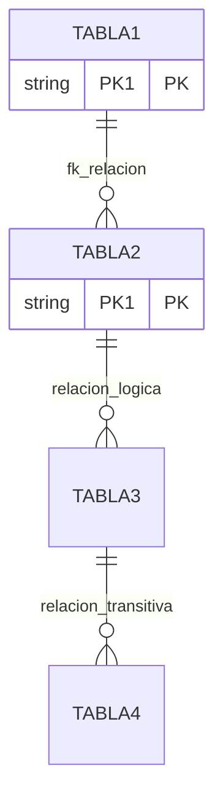

# Skill: Generar Diagrama ER REEF

## Objetivo

Construir un diagrama entidad-relación (ER) en formato Mermaid utilizando la información obtenida durante el análisis de dependencias REEF.

El diagrama debe reflejar:

- Relaciones físicas reales.
- Relaciones lógicas directas.
- Relaciones lógicas transitivas.
- Tablas funcionales.
- Tablas técnicas asociadas.

Esta skill corresponde al Paso 2 del flujo y consume obligatoriamente la salida tabular del Paso 1.

---

## Cuándo utilizar esta skill

Utilizar cuando sea necesario:

- Entender un modelo de datos REEF.
- Analizar una entidad funcional.
- Documentar una integración.
- Comprender dependencias entre tablas.
- Investigar flujos de navegación funcional.
- Documentar el modelo de terceros.
- Crear documentación técnica de base de datos.

---

## Entradas

Resultado producido por:

```text
sk-analizar-relaciones-tablas-reef
```

La entrada debe contener:

```text
Tablas relacionadas.
Claves primarias.
Relaciones físicas.
Relaciones lógicas.
Paquetes puente.
```

---

## Modelo de Construcción

El diagrama se genera en tres capas.

---

# Capa 1 - Relaciones Físicas

Representa únicamente relaciones reales de base de datos.

Fuentes válidas:

```text
Foreign Keys
Constraint Type = R
```

---

## Regla

Solo incluir:

```text
Relaciones obtenidas de ALL_CONSTRAINTS.
```

---

## Cardinalidades

### Uno a Uno

```text
||--||
```

---

### Uno a Muchos

```text
||--o{
```

---

## Sin relaciones físicas

Si no existen FKs reales:

```text
Sin relaciones físicas
```

y continuar con la capa lógica.

En Mermaid mantener la capa fisica sin aristas y pasar a capas logicas.

---

# Capa 2 - Relaciones Lógicas Directas

Representa tablas utilizadas conjuntamente de forma directa.

Fuentes válidas:

```text
Paquetes DL_*
Paquetes TRN_*
Dependencias Oracle
Consultas compartidas
```

---

## Criterio

Dos tablas están relacionadas lógicamente cuando:

```text
Aparecen utilizadas por el mismo paquete.
```

o

```text
Existe navegación directa entre ellas.
```

---

## Cardinalidad

Usar:

```text
||--o{
```

salvo evidencia de:

```text
1 a 1
```

Aplicar `||--||` solo si existe evidencia explicita; en caso contrario usar `||--o{`.

---

# Capa 3 - Relaciones Lógicas Transitivas

Representa tablas alcanzadas mediante uno o más saltos funcionales.

Especialmente:

```text
DF_THP_NWT_XX_*
RL_THP_NWT_XX_*
```

---

## Objetivo

Visualizar:

```text
Información complementaria.
Relaciones de terceros.
Datos extendidos.
Relaciones indirectas.
```

---

## Cardinalidad

Siempre utilizar:

```text
||--o{
```

En esta capa, usar siempre `||--o{`.

---

# Representación de Entidades

Cada tabla debe incluir:

```text
Nombre de tabla.
Claves primarias.
```

---

## Ejemplo

```mermaid
A1001399 {
    string COD_CIA PK
    string TIP_DOCUM PK
    string COD_DOCUM PK
}
```

---

# Procedimiento

## Paso 1

Construir inventario de entidades.

Para cada tabla incluir:

```text
Nombre.
Claves primarias.
```

---

## Paso 2

Añadir relaciones físicas.

Fuente:

```text
ALL_CONSTRAINTS
```

---

## Paso 3

Añadir relaciones lógicas directas.

Fuente:

```text
Paquetes puente.
Dependencias Oracle.
```

---

## Paso 4

Añadir relaciones transitivas.

Fuente:

```text
DF_THP_NWT_XX_*
RL_THP_NWT_XX_*
```

---

## Paso 5

Etiquetar relaciones.

Ejemplos:

```text
fk_cliente
fk_direccion
paquete_thp
integracion_tercero
```

---

## Salida Obligatoria

Orden de entrega:

1. Resumen fisico.
2. Resumen logico directo.
3. Resumen logico transitivo.
4. Diagrama Mermaid final.

### Resumen físico

```text
Tabla origen
Tabla destino
Tipo relación
```

---

### Resumen lógico directo

```text
Tabla origen
Tabla destino
Paquete puente
```

---

### Resumen lógico transitivo

```text
Tabla origen
Tabla destino
Nivel
```

---

### Diagrama Mermaid

Formato obligatorio:



---

# Restricciones

No inventar relaciones.

No inferir FKs inexistentes.

No utilizar:

```text
Relaciones hipotéticas.
Relaciones no descubiertas.
```

El diagrama debe basarse exclusivamente en:

```text
Foreign Keys.
Dependencias Oracle.
Paquetes puente.
```

---

# Preguntas que esta skill debe responder

```text
¿Cómo se relaciona esta tabla con el resto del modelo?

¿Qué relaciones son físicas?

¿Qué relaciones son funcionales?

¿Qué tablas extienden la información principal?

¿Cómo navega REEF entre estas entidades?

¿Cuál es el grafo real de dependencias?
```

---

# Definición de éxito

La skill se considera completada cuando:

- Todas las tablas identificadas aparecen representadas.
- Las claves primarias quedan reflejadas.
- Las relaciones físicas se distinguen de las lógicas.
- Las tablas DF_* y RL_* quedan conectadas correctamente.
- El resultado puede visualizarse directamente mediante Mermaid.
- El diagrama refleja fielmente el modelo descubierto durante el análisis.